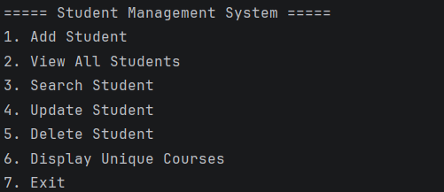

# Student Management System

## Project Description
A console-based Java application to manage student records using a menu.
Student data is saved in a text file, so it stays after the program closes.

## Features
- Add, view, search (by ID or name), update and delete student records
- Unique student IDs and automatic grade calculation
- Display of unique courses
- Data saved to students.txt and loaded again when the program starts
- Backup file created on exit using a separate thread
- Input validation with clear error messages

## Technologies Used
- Java (JDK 24)
- IntelliJ IDEA
- Git and GitHub

## Java Concepts Used
Classes and objects, constructors, this, static, inheritance, polymorphism,
encapsulation, abstraction, interface, abstract class, exception handling,
ArrayList, HashSet, HashMap, StringBuilder, file handling, multithreading

## How to Run the Project
1. Clone the repository or download it as a ZIP
2. Open the folder in IntelliJ IDEA
3. Run Main.java
4. Choose an option from the menu by typing a number from 1 to 7

## Sample Output

## Future Improvements
- A graphical user interface
- Storing the data in a database
- Login system for the admin
- Sorting and report generation